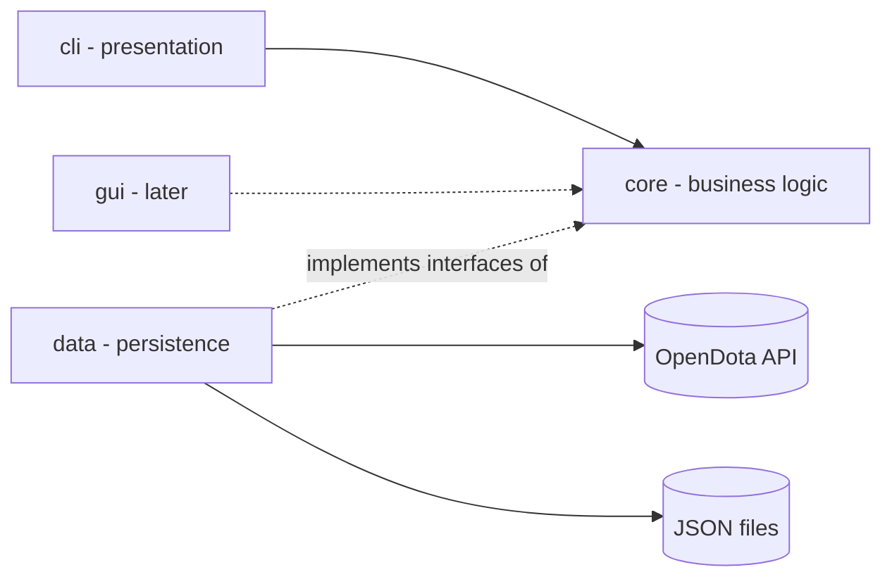
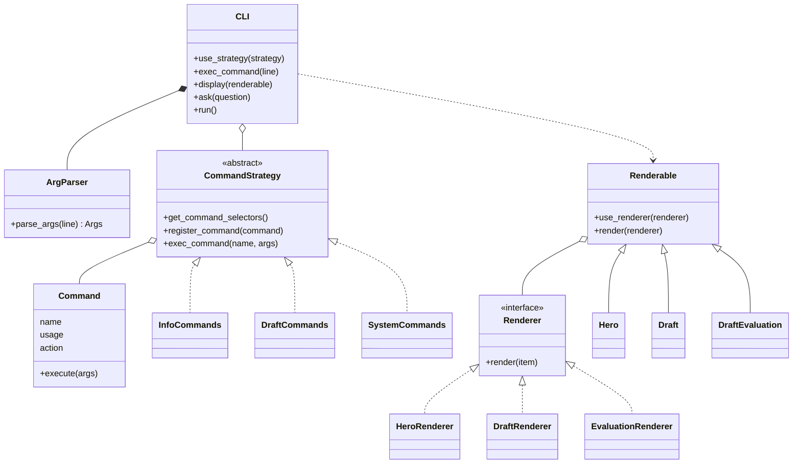
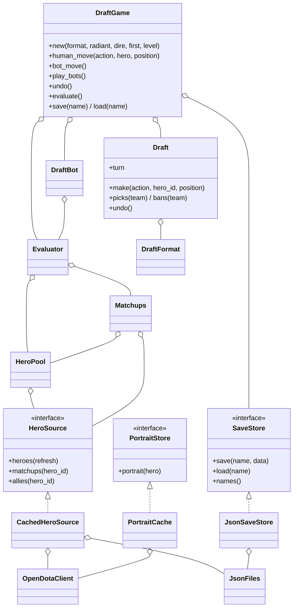
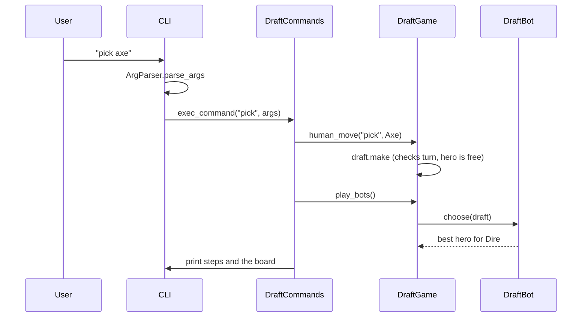

# Dota 2 Draft Simulator
## Software Design Document

Name: Ivan

Date: 24.11.2026

## Summary

- [1 Introduction](#1-introduction)
- [2 System Overview](#2-system-overview)
- [3 System Architecture](#3-system-architecture)
- [4 Data Design](#4-data-design)
- [5 Component Design](#5-component-design)
- [6 Human Interface Design](#6-human-interface-design)
- [7 Requirements Matrix](#7-requirements-matrix)

## 1 Introduction

### 1.1 Purpose

This document describes how the draft simulator is built. It is for the teacher and for anyone who wants to read or change the code.

### 1.2 Scope

In Dota 2, before a match two teams (Radiant and Dire) take turns banning and picking heroes. A good draft wins half the game: you pick heroes that are strong against the enemy's heroes and cover all five positions.

The app simulates this draft. Each team is played by a human or a bot. When the draft is over, the app compares the two drafts and says who "outdrafted" whom and with what chance. Drafts can be saved and continued later. Results of finished drafts are kept.

Right now the app has a console interface. A graphical interface will be added later on top of the same core.

### 1.3 Overview

Section 3 shows the layers and how they talk to each other, section 4 shows the data, section 5 explains the math of the draft score and the bot. Section 6 describes the console interface in detail.

### 1.4 Reference Material

- OpenDota API: https://docs.opendota.com (REST and the SQL explorer over public matches)
- Empirical Bayes shrinkage of winrates: https://en.wikipedia.org/wiki/Empirical_Bayes_method
- Captains Mode order: patch 7.40 (first ban phase changed to F-F-S-S-F-S-S)

### 1.5 Definitions

- **Pick / ban** - taking a hero to your team / removing a hero from the draft.
- **Captains Mode (CM)** - draft with 14 bans and 10 picks in a fixed order (24 steps).
- **All Pick (AP)** - here: only picks, in order 1-2-2-2-2-1.
- **Position 1-5** - carry, mid, offlane, pos 4 (soft support), pos 5 (hard support). In this app the roles of a hero are its positions.
- **Counter pick** - a hero that wins often against a certain enemy hero.
- **Matchup** - statistics of one hero against another: games and wins.
- **Strategy** - a group of console commands plugged into the CLI.

## 2 System Overview

The user types commands like `new`, `ban pudge`, `pick axe --pos=3`. The CLI parses the line, finds the strategy that owns the command and runs it. The commands use the core: `DraftGame` checks whose turn it is, makes the step, lets the bot answer, and when the draft is over `Evaluator` gives points to both teams.

The core gets heroes, matchups and synergy through the `HeroSource` interface. The data layer implements it with OpenDota and a local JSON cache: statistics of the current patch are downloaded once and then read from files.

## 3 System Architecture

### 3.1 Architectural Design

The app has three layers, like in the course diagram:



- **core** - heroes, matchups, positions, draft rules, evaluation, bot, saves logic. It doesn't import anything from `cli` or `data`.
- **data** - OpenDota client, JSON parsing, cache and save files. It implements `HeroSource` and `SaveStore` from the core.
- **cli** - console interface: parser, commands, renderers, colors and tables.
- **app.py** - creates all the objects and connects them.

### 3.2 Decomposition Description

Console interface:



Core and data:



What happens on `pick axe` when Dire is a bot:



### 3.3 Design Rationale

- **Strategies in a CLI facade.** Commands are split into three groups the way the task suggests: output (Info), actions that change the game (Draft) and infrastructure (System). A new group is a new class plus one `use_strategy` call, the CLI itself doesn't change. The CLI refuses a command name that two strategies register.
- **Renderable + Renderer.** I picked the second variant from the task: core classes are `Renderable`, the `Renderer` interface is also in the core, and the CLI implements it. The core knows nothing about colors or tables, and the GUI will set its own renderers later.
- **Interfaces for data.** The core defines `HeroSource`, `SaveStore` and `PortraitStore`, the data layer implements them. The tests use a fake source with 26 heroes and made-up matchups, without internet.
- **Console abstraction.** `Console` has `TerminalConsole` and `MemoryConsole`, so the whole CLI is tested with prepared input.
- **Divine+ public matches of the current patch, counted on OpenDota's side.** OpenDota's `/heroes/{id}/matchups` has only pro matches (20-100 games per pair) and doesn't care about the patch. Instead the app sends SQL to OpenDota's explorer and lets their database count every pair of heroes - against each other and in one team - in public matches since the current patch came out, with an average rank of Divine or higher (`avg_rank_tier >= 70`, ~8% of all games). Low ranks were left out on purpose: there a draft matters less than how people play. A query is limited to 15 seconds, so the matches are split into windows of 800 000 match ids, two queries per window (~30 seconds). After the first week of patch 7.42 that is ~300 000 matches; a usual pair has ~650 games. It is downloaded once on the first start and then with `refresh`.
- **Saves keep steps, not the board.** A draft is saved as its list of steps, the board is rebuilt from it. This also gives the history of steps for free.

## 4 Data Design

### 4.1 Data Description

All files are in `~/.dotadraft` (or the folder given with `--data=DIR`). A folder in the user's home whose name starts with a dot is the usual place for the files of a console app on every system. The folder where the app itself lies may be read-only, or it may be replaced by a new version.

| File | What is inside |
|---|---|
| `cache/heroes.json` | parsed `/heroStats`: id, name, attribute, attack type, aliases, image link (Valve's role tags are not used); plus games per lane from `/scenarios/laneRoles` (4 requests, one per lane) |
| `cache/patch.json` | version, patch name, its start time, number of matches, `pairs` - `[hero, enemy, games, wins]` and `allies` - `[hero, ally, games together, wins together]` from Divine+ matches of the patch |
| `saves/<name>.json` | one saved draft; `autosave` is written on exit and loaded on start |
| `saves/_results.json` | results of all finished drafts |
| `images/<key>.png` | hero portraits from Valve's CDN (`skeleton_king.png`, ~70 KB each, ~9 MB for all heroes) |

Save example:

```json
{
  "draft": {"format": "cm", "first": "radiant",
            "steps": [["radiant", "ban", 48, null], ["radiant", "pick", 14, 4]]},
  "players": {"radiant": "human", "dire": "bot"},
  "level": "normal",
  "result_written": false
}
```

### 4.2 Persistence

Two kinds of files are kept between runs:

- **Serialized objects, as JSON.** JSON is the format OpenDota already answers in, it is compact and Python reads it without extra packages. A database would be too much here: the app keeps a few files, never searches inside them and is used by one person.
- **Raw bytes, as PNG files.** The portraits are saved exactly as the server sent them.

What is written and when:

| What | Who writes it | When it is written | When it is read |
|---|---|---|---|
| hero list | `CachedHeroSource` | on the first start and on `refresh` | every start |
| patch stats | `CachedHeroSource` | on the first start and on `refresh` | when a matchup is needed for the first time |
| draft save | `DraftGame.save` through `JsonSaveStore` | `save [name]`; `autosave` on exit, also after a single command run from the program arguments | `load [name]`; `autosave` on start |
| results | `DraftGame` | once, when a draft is over (removed again by `undo`) | `results` |
| portraits | `PortraitCache` | the first time a hero is shown, or all at once with `portraits` | before downloading, to skip what is already there |

Rules for all of them:

- **Atomic writes.** A file is written as `.tmp` first and then renamed over the old one, so a crash or Ctrl+C never leaves half a file.
- **Cache version.** `heroes.json` and `patch.json` have `"version": 6`. When the format changes, the number is raised and old files are downloaded again instead of crashing. `Hero.from_dict` also ignores fields it doesn't know.
- **A save keeps the steps, not the board.** `Draft.to_dict` writes the format, who picks first and the list of steps; `Draft.from_dict` builds the draft again from them. Players, bot level and whether the result was written are saved next to it, so after `load` the game goes on from the same step.
- **Continue from the last save.** On start the app loads `autosave`. If that draft is not over, it says "Continuing the last draft".
- **Portraits are a buffer.** `PortraitCache.portrait(hero)` returns the local file. Only if there is no file, it downloads the picture, checks that it really is a PNG and writes it. Each picture is downloaded once, and the app works offline with them later. A new hero of a new patch is downloaded the first time it is shown. `portraits --again` deletes the pictures and downloads them all again (if Valve changes the art).
- **Names starting with `_`** are reserved for the app's own files (`_results`), the user can't save or load them.

### 4.3 Data Dictionary

| Entity | Fields / methods |
|---|---|
| `Args` | `name`, `positional`, `options`; `get(i)`, `option(name)` |
| `Command` | `name`, `usage`, `summary`, `action`, `min_args`; `execute(args)` |
| `Draft` | `format`, `first`, `steps`; `turn`, `make`, `undo`, `picks`, `bans`, `fixed_positions` |
| `DraftEvaluation` | `radiant`, `dire` (TeamScore), `key_matchups`, `key_synergies`; `radiant_chance`, `winner` |
| `DraftFormat` | `key`, `title`, `order` - list of (first/second, pick/ban) |
| `Hero` | `id`, `name`, `key`, `attribute`, `attack_type`, `aliases`, `image_url`, `games`, `wins`, `lanes`; `winrate` |
| `HeroPool` | `all`, `get(id)`, `find(text)`, `filter(role, attribute)`, `refresh` |
| `PortraitCache` | `root`; `portrait(hero)` -> local file, `missing(heroes)`, `download_all(heroes, on_progress)`, `clear()` |
| `Matchups` | `strength(id)`, `expected(a, b)`, `winrate(a, b)`, `advantage(a, b)`, `synergy(a, b)`, `best_allies(id)`, `counters_of(id)`, `good_against(id)` |
| `Step` | `team`, `action`, `hero_id`, `position` |
| `TeamScore` | `counters`, `synergy`, `strength`, `positions`, `composition`, `roles`, `problems`; `total` |

## 5 Component Design

### 5.1 Matchups and synergy

Matchups come from Divine+ public matches of the current patch (all pick, captains mode, ranked all pick; no turbo).

A strong hero wins against almost everyone: Riki has 56% in the patch, so he also has ~56% against a random enemy. That is the hero's strength, not a counter pick, and it is already counted in "hero strength" (5.3). So the advantage of a pair is how much better it does **than expected** from the winrates of the two heroes. The expectation uses log-odds, the usual way to add up chances:

```
strength(h)     = ln(w / (1 - w))                 # w = winrate of h in the patch; 50% -> 0, 56% -> +0.24
expected(a, b)  = 1 / (1 + e^(strength(b) - strength(a)))
winrate(a, b)   = (wins + 800 * expected(a, b)) / (games + 800)
advantage(a, b) = winrate(a, b) - expected(a, b)  # advantage(a, b) = -advantage(b, a)
```

Synergy of two heroes in one team is the same idea: in log-odds the strengths of teammates add up.

```
expected_together(a, b) = 1 / (1 + e^-(strength(a) + strength(b)))
synergy(a, b)           = (wins + 2000 * expected_together) / (games + 2000) - expected_together
```

**Why 800 and 2000 imaginary games.** A usual pair has ~650 Divine+ games, and on 650 games luck alone moves a winrate by about 2%. The data was checked (empirical Bayes): the spread of all pair winrates around their expectation is 2.9%, of which 2.4% is what luck gives, so real counter picks are only about 1.7%. With that much noise the best guess for a pair is a mix of its own result and the expectation, with weight `games / (games + K)`, where `K = 0.25 / 0.017^2 ~ 875`. For synergy the real effects are smaller (1.0%), so K is ~2350. The numbers are rounded to 800 and 2000. Without this the program believed every random 120-game pair.

Examples:
- Ursa (49.6%) against Riki (56.2%), 1118 games. The raw winrate is 40.7%, which looks like a hard counter, but the expectation is already 43.4%, so after the smoothing the advantage is -1.6%: Riki is just strong.
- Winter Wyvern against Meepo, 196 games: real 58.2%, expected 45.4%. The pair has few games, so the advantage is +2.5% and not +12.8%, but it is still one of the biggest for Meepo.

The winrate of a hero in the patch is taken from the same table: every game of a hero is counted once against each of the 5 enemies, so `games = sum of its pair games / 5`.

How the tables are built (`CachedHeroSource.download_patch_stats`):

```
patch, start = last entry of /constants/patch
newest = max(match_id) of public matches
go back by 800 000 ids until the first match of the window is older than the patch
for every window, matches with avg_rank_tier >= 70 only:
    SQL 1: unnest radiant heroes x dire heroes -> (a, b, games, radiant wins)
           add (a vs b: games, wins) and (b vs a: games, games - wins)
    SQL 2: unnest pairs inside each team -> (a, b, games together, wins together)
           add it for (a, b) and (b, a)
```

### 5.2 Positions

OpenDota doesn't say "Axe is position 3". Valve's role tags (Carry, Support, Nuker...) are not used: they are years old (Wraith King and Underlord are tagged "Support").

- **Lanes** come from the statistics: `/scenarios/laneRoles` - how many public games each hero spent on the safe lane, mid, off lane and in the jungle. A lane gives two positions: safe lane = pos 1 or pos 5, off lane = pos 3 or pos 4, mid = pos 2.
- **Core or support on that lane** is written by hand in `core/hero_notes.py`: the **support share**, how often the hero is played as a support in the current meta. Nothing in OpenDota's public data shows it reliably (a try with the items heroes buy gave Ogre Magi as a carry and Zeus as a support), and for a player of the game it is common knowledge.

```
support = 1.0  pure supports: Crystal Maiden, Lion, Shadow Shaman, Rubick...
          0.8  mostly supports: Earthshaker, Mirana, Silencer, Phoenix...
          0.5  played both ways: Abaddon, Pudge, Enigma, Marci
          0.2  mostly cores: Underlord, Magnus, Kunkka, Lina...
          0    every hero that is not in the table: Juggernaut, Wraith King, Axe...
```

Example, Wraith King: lanes are half safe, half off, support = 0, so the scores below give carry 0.51 and offlane 0.47.

Then, with `safe`, `mid`, `off` as parts of the hero's games:

```
score(pos 1) = safe * (1 - support)
score(pos 2) = mid  * (1 - support / 2)
score(pos 3) = off  * (1 - support)
soft = off  * support + mid * support / 2     # a support on mid is a roaming 4
hard = safe * support
score(pos 4) = max(soft, 0.8 * hard)          # supports swap 4 and 5 easily,
score(pos 5) = max(hard, 0.8 * soft)          # so the other support position gives 80%

best position = the biggest score
fitness(hero, pos)  = score(pos) / score(best position)        # 0..1
playable(hero, pos) = min(fitness / 0.55, 1)                   # 55% of the best one is fine
```

`playable` is there because both the lanes and the support share are a guess: Zeus is mid 45%, offlane 40%, so both are fine for him. A carry as hard support (Slark: 0.08) is still punished.

The `hero` command shows the raw scores (without the 4/5 swap) divided by their sum, as a guess of how often the hero plays each position. The hero's **roles** are the positions with at least 20% of that (and always the first one): Wraith King - Carry, Offlane; Bane - Pos 5, Pos 4; Zeus - Mid, Offlane.

Example, Sven: lanes are safe 97%, support = 0, so pos 1 = 0.97, the best.

With the current data the best positions of the heroes split 32 / 26 / 22 / 25 / 22 over positions 1-5. A player can still fix a position with `pick <hero> --pos=N`. A hero with less than 100 lane games (a brand new one) can play any position, and a new hero that is not in the table counts as a core until it is added.

Heroes of a team get positions so the sum of scores is the biggest (all variants are tried, 5! = 120 at most); fixed positions stay, the others are placed around them.

### 5.3 Draft score

The points are made so that **1 point of difference is about 1% of win chance** (near 50%). Everything is counted in log-odds and multiplied by 25, because the logistic curve at 50% rises by 1/4 per unit of log-odds.

For each team:

```
counters    = sum over own hero x enemy hero of weight * advantage * 100 / 2
synergy     = sum over pairs of own heroes of synergy * 100
strength    = 25 * 0.5 * sum over own heroes of strength(h)
positions   = -10 * sum over assigned heroes of (1 - playable^2)
composition = - penalties of the rules below (only when the team has 5 heroes)
total       = counters + synergy + strength + positions + composition
```

**Counters are weighted by positions.** A carry against a carry decides more than a support against a support, and heroes standing on one lane meet for the first 10 minutes:

```
weight(a, b) = W[pos a] * W[pos b] * (1.5 if they meet on a lane)
W = {1: 1.25, 2: 1.25, 3: 1.0, 4: 0.75, 5: 0.75}       # adds up to 5, so 25 pairs still weigh ~25
lanes: pos 1 and 5 on the safe lane meet enemy pos 3 and 4 on their off lane; mid meets mid
```

So Juggernaut against Axe (1 vs 3, one lane) weighs 1.25 * 1.0 * 1.5 = 1.9, Crystal Maiden against Lion (5 vs 5) only 0.56.

**Composition rules.** Two traits of a hero are written by hand in `core/hero_notes.py` too:

- **initiator** - starts a fight: a long stun, a blink-in or a big area spell (Axe, Enigma, Magnus, Tidehunter, Earthshaker, Mars...)
- **frontline** - stands in front and takes the damage (Axe, Bristleback, Centaur, Tidehunter, Underlord, Wraith King...)

| Problem | Penalty | Check |
|---|---|---|
| no initiator | -4 | no initiator among the 5 heroes |
| no frontline | -3 | no frontline among the 5 heroes |
| all melee / all ranged | -3 | the same attack type for all 5 |

The problems are printed under the table ("Dire lacks: no initiator"). Under the key matchups the three pairs of teammates with the biggest synergy (good or bad) are shown as key synergies.

- Counters are zero-sum: a counter pick helps one team as much as it hurts the other, so each team gets half and the gap between the teams is the whole effect. Synergy is not halved: it is only about one team.
- Strength has weight 0.5. A winrate in public games is not all about the hero: Meepo has 57% partly because mostly Meepo one-trick players pick him. Taking half of it keeps meta heroes good, but not unbeatable. Five 55% heroes against five 50% heroes give ~12 points.
- Positions: a playable position costs nothing, a position nobody in the team can play costs 10 points. Squared, so a support playing carry (playable 0.4 -> 0.16) costs almost the full 10.

Win chance (logistic curve):

```
radiant_chance = 1 / (1 + e^(-(radiant.total - dire.total) / 25))
```

10 points of difference gives ~60%, 25 points ~73%, 50 points ~88%. The team with the bigger chance "outdrafted" the other one; at 48-52% the drafts are called even. The three pairs that changed the score the most (advantage times weight) are shown as key matchups.

### 5.4 Bot

```
gain(team, hero) = total(team with hero) - total(enemy)     # enemy total also changes, counters are zero-sum

choose():
    if it's a pick: rank all free heroes by gain for own team
    if it's a ban:  rank all free heroes by gain for the ENEMY (take away their best pick)
    take a random hero from the top N: hard N=1, normal N=3, easy N=8
```

`suggest` shows the same ranking to a human player.

### 5.5 Game flow

```
DraftGame.human_move(action, hero, pos):
    error if it's the bot's turn
    draft.make(...)      # checks: right action now, hero is free, position 1-5 and free
    if the draft is over: write the result once

DraftGame.play_bots():
    while the draft is not over and the current team is a bot: bot_move()

DraftGame.undo():
    take back the last step, and the bot steps before it, back to the human's step
    if this draft's result was written: remove it
```

## 6 Human Interface Design

### 6.1 Overview of User Interface

```
python main.py                     interactive mode
python main.py counters pudge      one command and quit
--data=DIR                         other folder for saves and cache
--no-color                         without colors
```

The draft mode is chosen with `new`: through options (`new --mode=cm --dire=bot --bot=hard`) or, without options, through questions. The prompt shows whose step it is: `draft [radiant pick]> `. Mistakes don't stop the program, they are printed in red as `Error: ...`. On start the last draft is loaded from `autosave`.

### 6.2 Screen Images

```
draft [radiant pick]> pick pudge --pos=4
Radiant picks Pudge (pos 4)
Dire picks Drow Ranger

Captains Mode, step 9/24
Pos        Radiant  Dire
-------------------------------
1 Carry    -        Drow Ranger
2 Mid      -        -
3 Offlane  -        -
4 Pos 4    Pudge    -
5 Pos 5    -        -
Radiant bans: Riki, Meepo, Troll Warlord
Dire bans: Abaddon, Wraith King, Visage, Omniknight
Next: Radiant bans (you) - type 'ban <hero>'
```

```
               Radiant   Dire
-----------------------------
Counter picks     +3.1   -3.1
Synergy           +1.2   -0.4
Hero strength     +1.8   +3.6
Positions         -0.0   -3.6
Composition       +0.0   -3.0
Total             +6.1   -6.5

Dire lacks: no initiator
Win chance: Radiant 62.3% [###################...........] 37.7% Dire
Key matchups:
  Ogre Magi is good against Visage (+2.1%)
Key synergies:
  Radiant: Ogre Magi and Pudge work well together (+1.0%)
  Dire: Drow Ranger and Vengeful Spirit work well together (+0.8%)
Radiant outdrafted Dire!
```

### 6.3 Screen Objects and Actions

| Group | Command | What it does |
|---|---|---|
| Info | `heroes [--pos=P] [--attr=A]` | table of heroes with roles and traits, filter by position (1-5, carry, mid, offlane) and attribute |
| | `hero <name>` | roles, traits, winrate in the patch, lanes, part of games on each position, local portrait file (downloaded the first time) |
| | `counters <hero>` | who is good against the hero, whom it is good against and with whom it works well |
| | `meta [count]` | heroes with the best winrate in the patch |
| | `board` / `history` | current draft / all steps |
| | `score` | the table from 5.3 for the current draft |
| | `results` | finished drafts with Radiant's chance |
| Draft | `new [options]` | new draft; options `--mode=cm\|ap --radiant=human\|bot --dire=human\|bot --first=radiant\|dire --bot=easy\|normal\|hard`, without options asks questions |
| | `pick <hero> [--pos=1-5]` / `ban <hero>` | a step of the human team |
| | `suggest [count]` | best heroes for this step with their gain |
| | `auto` | the bot makes this step |
| | `undo` | take back the last human step |
| System | `refresh` | download fresh stats of the current patch with a progress bar |
| | `portraits [--again]` | download portraits of all heroes with a progress bar (~10 seconds); `--again` downloads them anew |
| | `save [name]` / `load [name]` / `saves` | named saves, default `autosave` |
| | `help` / `exit` | command list / save and quit |

Heroes are found by full name, part of the name, OpenDota aliases or initials: `am`, `sf`, `cm`, `jugg`, `"crystal maiden"`. If the text fits several heroes, the app lists them.

Console-only elements are in `cli/graphics.py`: `Style` (ANSI colors, team and attribute colors, turned off when the output isn't a terminal), `Table` (columns are aligned even with color codes inside), bars and the progress bar.

## 7 Requirements Matrix

| Requirement (topic 3, practice 13) | Where |
|---|---|
| Operations of the topic: draft with bans and picks, bot, undo | `DraftCommands`, `DraftGame`, `Draft`, `DraftBot` |
| Output of the needed information | `InfoCommands`, renderers in `cli/renderers.py` |
| Choosing the mode through arguments or dialog | `new` with options or questions; `main.py` runs one command from arguments |
| Commands with arguments and options | `ArgParser`, `Args`, `Command` |
| Classes ready for more commands | `CommandStrategy`, `CLI.use_strategy` |
| Structured output of objects | `Renderable` / `Renderer`, `Table` |
| Saving state and results | `DraftGame.save/load`, autosave, `_results`, `JsonSaveStore` |
| Loading data from the server | `OpenDotaClient` (REST + explorer SQL), `parse_heroes`, `parse_lanes`, `CachedHeroSource` |

| Requirement (practice 14, business logic) | Where |
|---|---|
| All the math of the draft, described in the document | 5.1 matchups and synergy, 5.2 positions, 5.3 draft score, 5.4 bot; code in `Matchups`, `positions.py`, `Evaluator`, `DraftBot` |
| Step-by-step game with actions | `Draft` with the Captains Mode / All Pick order of `Step`s, `DraftGame.human_move/bot_move/undo` |
| History of the steps | `Draft.steps`, the `history` command |
| Saving the game state | `Draft.to_dict/from_dict`, `DraftGame.save/load`, autosave |
| Loading new heroes | `HeroSource` interface; `CachedHeroSource` downloads the heroes of a new patch, `refresh` downloads them again |
| Core with no links to other layers | `core` imports nothing from `cli` or `data`; `HeroSource` and `SaveStore` are implemented in `data` |

| Requirement (practice 15, persistence) | Where |
|---|---|
| Saving the game state and loading it back | `DraftGame.save/load`, `Draft.to_dict/from_dict`, `JsonSaveStore`, `JsonFiles`; commands `save`, `load`, `saves` |
| The game goes on from the last save | `autosave` on exit, `App.start` loads it |
| Hero portraits saved to local files, fewer requests to the server | `PortraitCache`, `OpenDotaClient.download`, command `portraits`, `hero` |
| Server data cached between runs | `CachedHeroSource` with `cache/heroes.json` and `cache/patch.json` |
| How it works is described in the document | 4.1 files, 4.2 persistence |
